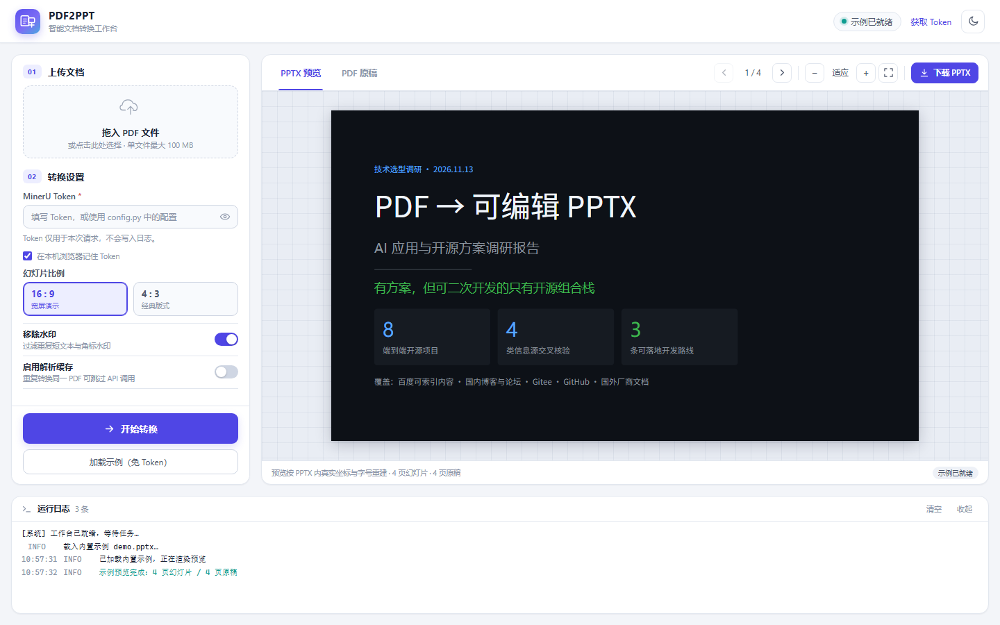
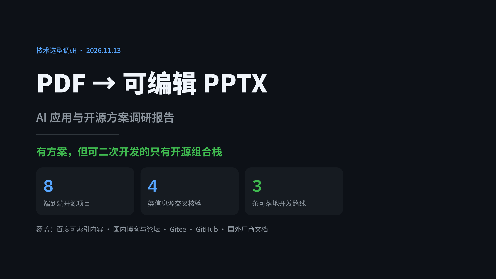
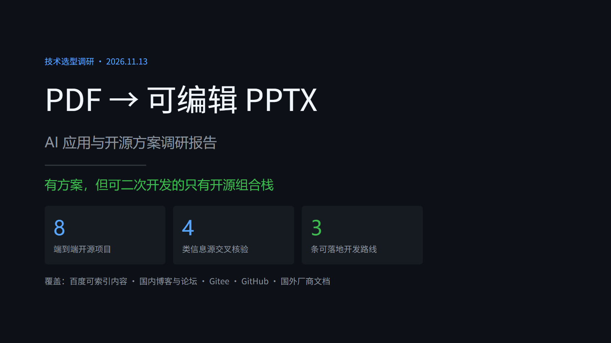
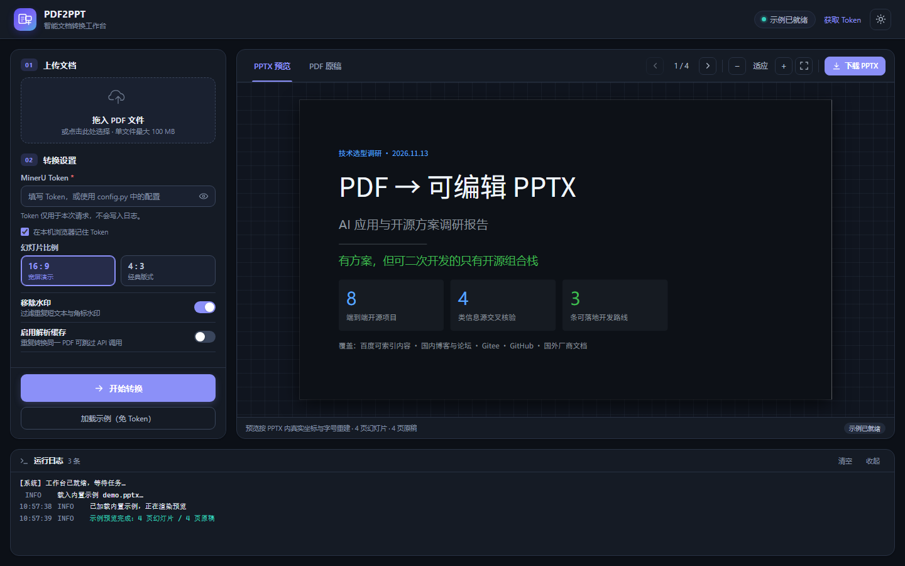
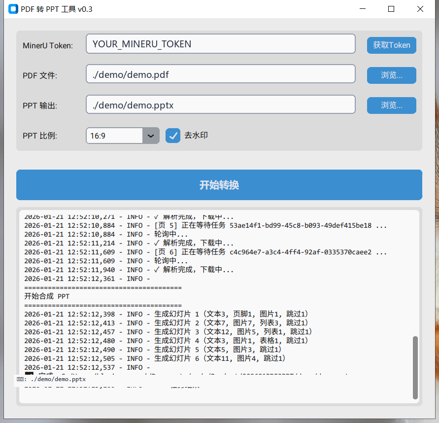
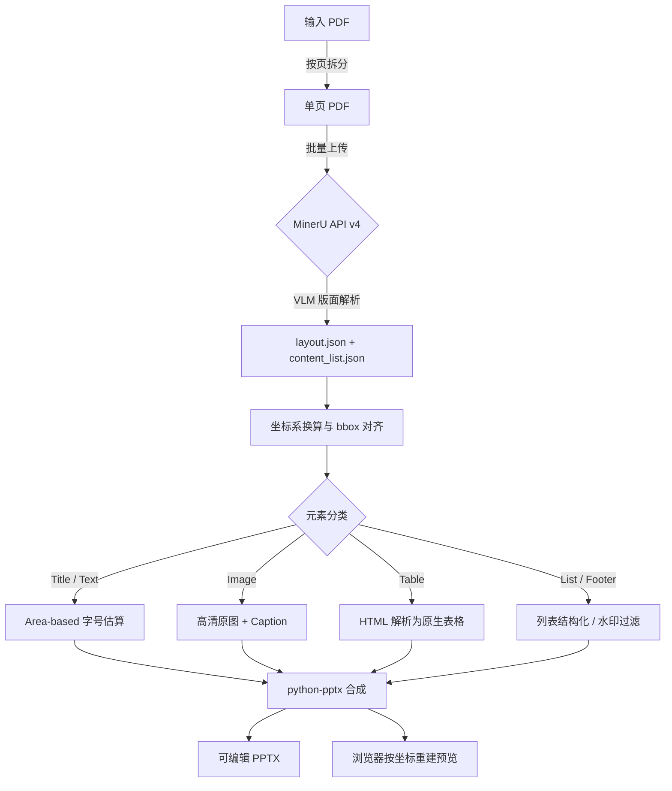

# PDF2PPT

<p align="center">
  
</p>

<p align="center">
  <a href="https://github.com/blacksamuraiiii/pdf2ppt/releases"></a>
  <a href="https://www.python.org/downloads/"></a>
  <a href="https://github.com/opendatalab/MinerU"></a>
  <a href="LICENSE"></a>
</p>

**把 PDF 变成真正可编辑的 PPTX** —— 文字仍是文本框、表格仍是原生表格、图片仍是独立图片，而不是把每一页截图塞进幻灯片。

本项目借助 [MinerU](https://github.com/opendatalab/MinerU) 的版面解析能力识别 PDF 中的标题、正文、图片、表格、列表与页脚，再按坐标用 `python-pptx` 重建为可继续修改的演示文稿。提供 **Web 工作台**、**桌面 GUI**、**命令行** 三种用法，并内置免 Token 示例。

<details>
<summary>🇬🇧 English — quick start</summary>

**PDF2PPT** converts PDF documents into **fully editable** PowerPoint slides (real text boxes, native tables and independent images), powered by [MinerU](https://github.com/opendatalab/MinerU) layout parsing plus `python-pptx`. It ships a Web workbench with side-by-side PPTX / PDF preview, a desktop GUI, and a CLI.

```bash
git clone https://github.com/blacksamuraiiii/pdf2ppt.git
cd pdf2ppt
uv python install 3.12 && uv venv --python 3.12
uv pip install -r requirements.txt
cp config.example.py config.py        # add your MinerU API token here
python webapp.py                      # http://127.0.0.1:5000/?demo=1
```

A [MinerU API token](https://mineru.net/apiManage/token) is required for real conversions; the bundled demo works without one. See the sections below (in Chinese) for configuration, FAQ and caveats.

</details>

## 目录

[亮点](#亮点) · [效果预览](#效果预览) · [快速开始](#快速开始) · [三种使用方式](#三种使用方式) · [配置项](#配置项) · [工作原理](#工作原理) · [项目结构](#项目结构) · [Agent Skill](#agent-skill) · [常见问题](#常见问题) · [贡献指南](#贡献指南) · [声明与素材版权](#声明与素材版权) · [致谢](#致谢) · [许可证](#许可证)

## 亮点

| 能力 | 说明 |
| --- | --- |
| 结构化还原 | 识别标题 / 正文 / 图片 / 表格 / 列表 / 页脚，按 bbox 精确定位到 PPT 页面 |
| 真正可编辑 | 输出的是文本框、原生表格、独立图片，可在 PowerPoint / WPS 里继续改 |
| 智能排版 | Area-based 字号估算、PDF↔PPT 坐标系换算、表格字号自适应、常见 LaTeX 符号转 Unicode |
| 水印过滤 | 基于关键词、位置与重复文本检测，去除 PDF 中反复出现的水印 |
| 浏览器预览 | 按 PPTX 内真实坐标、字号与填充色在浏览器里重建，**无需安装 Office / LibreOffice**；可与 PDF 原稿逐页对照 |
| 三种入口 | Web 工作台（浅/深主题、实时日志、进度、翻页缩放、下载）／桌面 GUI／命令行 |
| 免 Token 体验 | 内置 4 页自有调研汇报示例，一键载入即可验收界面与预览效果 |

## 效果预览

示例素材是项目自带的 **「PDF → 可编辑 PPTX」调研汇报**（自有内容，不含第三方产品图或品牌标识）。左侧是扁平化的 PDF 原稿（无文本层、整页不可直接编辑），右侧是**同源可编辑 PPTX 在内置预览器中的重建效果** —— 文字、卡片、深色底都是独立形状，能直观看出「整页图片」与「可编辑元素」的差别。

> 说明：下面这两张是同源素材的对照示意，**不是 MinerU 实时转换的产物**；真实转换流程见 [快速开始](#快速开始)。

| PDF 原稿（扁平化） | 可编辑 PPTX 的预览重建 |
| :---: | :---: |
|  |  |

Web 工作台支持浅色 / 深色主题，主题只改变工具外壳，幻灯片保持**原始背景**。示例本身就是深色稿，预览器会补一圈描边，保证深色舞台上也能看清画布边界：

| 浅色主题 | 深色主题 |
| :---: | :---: |
|  |  |

<details>
<summary>查看更多界面截图</summary>

- [`screenshots/02-slide-page3-light.png`](screenshots/02-slide-page3-light.png) — 翻页与卡片版式还原
- [`screenshots/04-pdf-source-dark.png`](screenshots/04-pdf-source-dark.png) — PDF 原稿逐页对照
- [`screenshots/05-empty-state-light.png`](screenshots/05-empty-state-light.png) — 上传前空状态
- [`screenshots/GUI.png`](screenshots/GUI.png) — 桌面 GUI
- [`screenshots/index.html`](screenshots/index.html) — 可离线打开的截图画廊（点击放大）

</details>

## 快速开始

### 1. 环境要求

| 项目 | 要求 |
| --- | --- |
| Python | 3.10 及以上（推荐 3.12） |
| 操作系统 | Windows / macOS / Linux 均可运行；exe 打包仅面向 Windows |
| MinerU Token | [前往 API 管理台](https://mineru.net/apiManage/token) 注册获取，真实转换必需（额度与计费以服务方为准） |
| 网络 | 转换阶段需访问 MinerU API；预览与示例可完全离线 |

### 2. 安装依赖

**方式 A：`uv`（推荐，速度快且自带锁文件能力）**

```bash
git clone https://github.com/blacksamuraiiii/pdf2ppt.git
cd pdf2ppt

uv python install 3.12
uv venv --python 3.12
uv pip install -r requirements.txt     # uv 会自动找到当前目录的 .venv，无需先激活
```

**方式 B：传统 `pip`**

```bash
python -m venv .venv
pip install -r requirements.txt
```

激活虚拟环境的写法因终端而异（Windows 上最容易踩坑的一步）：

| 终端 | 激活命令 |
| --- | --- |
| Git Bash / MSYS | `source .venv/Scripts/activate` |
| CMD | `.venv\Scripts\activate.bat` |
| PowerShell | `.venv\Scripts\Activate.ps1` |
| macOS / Linux | `source .venv/bin/activate` |

> 小提示：命令以 `uv` 开头（`uv pip install`、`uv run python app.py`）时不必激活；直接敲 `python` / `pip` 才需要先激活。PowerShell 若提示执行策略限制，可先执行 `Set-ExecutionPolicy -Scope CurrentUser RemoteSigned`。

### 3. 配置 Token

```bash
cp config.example.py config.py     # Windows CMD: copy config.example.py config.py
```

然后编辑 `config.py`，至少填入 Token 与输入输出路径：

```python
MINERU_TOKEN = "你的_MINERU_TOKEN"
PDF_INPUT_PATH = "./input.pdf"
PPT_OUTPUT_PATH = "./output.pptx"
```

> ⚠️ **`config.py` 含你的 API Token，已被 `.gitignore` 忽略，切勿提交到仓库。** Web 界面也支持在页面直接填 Token（留空则回退读取 `config.py`）；勾选「记住 Token」会把它保存在本机浏览器的 localStorage，公用电脑请勿勾选。

### 4. 先跑一遍免 Token 示例

```bash
python webapp.py
# 浏览器打开 http://127.0.0.1:5000/?demo=1 ，或点击页面上的「加载示例」
```

内置的 `demo/demo.pdf`（4 页扁平化原稿）与 `demo/demo.pptx`（4 页同源可编辑稿）来自项目自带的调研汇报，可直接验收预览、主题、翻页与下载，不需要 Token、不消耗 API 额度。

## 三种使用方式

| 方式 | 启动命令 | 适用场景 | 需要 Token |
| --- | --- | --- | --- |
| Web 工作台 | `python webapp.py` | 可视化上传、逐页预览、对照原稿、下载 | 真实转换需要；示例不需要 |
| 桌面 GUI | `python app.py` | 本机单机使用，拖拽选文件 | 是 |
| 命令行 | `python pdf2ppt.py` | 批处理、脚本集成；参数全部来自 `config.py` | 是 |
| 可执行文件 | [下载 v0.3 exe](https://github.com/blacksamuraiiii/pdf2ppt/releases/download/v0.3/PDF2PPT_Tool.exe) | 免装 Python 的 Windows 用户 | 是 |
| Agent Skill | 见 [Agent Skill](#agent-skill) | AI Agent 调用 | 是 |



### Web 工作台

```bash
python webapp.py                      # 默认 http://127.0.0.1:5000
python webapp.py --port 8080          # 换端口
python webapp.py --host 0.0.0.0       # 允许局域网访问（无鉴权，请勿直接暴露公网）
```

| Web 能力 | 说明 |
| --- | --- |
| PPTX 逐页预览 | 按 EMU 坐标、字号与填充色重建文本框、图片、原生表格和纯色矩形 / 圆角形状，无需 Office |
| PDF 原稿对照 | 用 PyMuPDF 渲染每一页，可与转换结果逐页切换比对，两个视图页码独立 |
| 主题切换 | 浅色 / 深色一键切换并本地持久化；`?theme=dark` 可直接分享；幻灯片保持原始背景 |
| 实时进度与日志 | 转换在后台线程执行，页面轮询展示阶段、进度条与运行日志 |
| 翻页 / 缩放 / 下载 | 键盘左右键翻页、适应窗口、自由缩放、一键下载 `.pptx` |
| 上传限制 | 单文件最大 100 MB |

> Web 层不改动 `app.py`（桌面版）与 `pdf2ppt.py`（转换核心），三者可并存。运行时产生的任务文件与预览图片放在 `web_outputs/`，该目录已被忽略，可随时清理。

### 打包 Windows exe

```bash
pip install pyinstaller
pyinstaller app.spec
```

`app.spec` 与 `version_info.txt` 已随仓库提供，产物在 `dist/`。

## 配置项

`config.example.py` 的完整字段（复制到 `config.py` 后按需修改）：

| 字段 | 示例值 | 说明 |
| --- | --- | --- |
| `MINERU_TOKEN` | `""` | MinerU API Token，真实转换必填 |
| `PDF_INPUT_PATH` | `"./demo/demo.pdf"` | 命令行模式输入的 PDF 路径 |
| `PPT_OUTPUT_PATH` | `"./demo/demo.pptx"` | 命令行模式输出的 PPTX 路径 |
| `USE_CACHE` | `False` | 复用已解析的 JSON，调试时可避免重复调用 API |
| `CACHE_DIR` | `"temp"` | 解析缓存目录 |
| `PPT_SLIDE_WIDTH` / `PPT_SLIDE_HEIGHT` | `16` / `9` | 幻灯片尺寸（英寸）；4:3 用 `10` / `7.5` |
| `REMOVE_WATERMARK` | `True` | 是否过滤重复水印 |

Web 与 GUI 版把「比例（16:9 / 4:3）」「去水印」「启用解析缓存」做成了界面开关，无需改配置文件。Agent Skill 额外支持 `MINERU_TOKEN` 环境变量传入。

## 工作原理



关键步骤：先分页并批量提交 MinerU，拿到带精确边界框的结构化 JSON；再统一 PDF 与 PPT 的坐标系，按元素类型分别处理（字号、图片、表格、水印）；最后生成 PPTX。Web 预览走的是另一条轻量路径：直接读取生成结果里的形状坐标、字号与填充色，在浏览器中重建文本框、图片、原生表格以及纯色矩形 / 圆角形状（深色底、卡片、分隔线），不依赖任何 Office 组件。

## 项目结构

```text
pdf2ppt/
├── pdf2ppt.py                 # 转换核心：MinerU 解析 → PPTX 生成
├── app.py                     # 桌面 GUI（CustomTkinter）
├── webapp.py                  # Web 后端（Flask + 后台任务 + 预览/下载接口）
├── preview_utils.py           # PPTX → 预览 JSON、PDF → 逐页 PNG
├── config.example.py          # 配置模板（复制为 config.py 使用）
├── requirements.txt
├── app.spec / version_info.txt  # PyInstaller 打包配置
├── templates/index.html       # Web 页面
├── static/style.css           # 样式与浅深主题
├── static/app.js              # 交互、预览渲染、轮询
├── demo/demo.pdf              # 4 页自有调研汇报（PDF 原稿）
├── demo/demo.pptx             # 4 页同源可编辑 PPTX
├── screenshots/               # 界面与效果截图
└── skill-pdf2ppt/             # AI Agent Skill 包
```

## Agent Skill

仓库附带标准的 Agent Skill 包，便于 AI Agent 直接调用转换能力：

```bash
python skill-pdf2ppt/scripts/main.py \
  --pdf_path "input.pdf" \
  --token "YOUR_TOKEN" \
  --output_path "output.pptx" \
  --ratio 16:9
```

也支持通过环境变量 `MINERU_TOKEN` 传 Token，以及 `--remove_watermark`、`--debug` 参数。详见 [`skill-pdf2ppt/SKILL.md`](skill-pdf2ppt/SKILL.md)。

## 常见问题

| 问题 | 解答 |
| --- | --- |
| 没有 MinerU Token 能用吗？ | 可以点「加载示例」或访问 `/?demo=1` 体验完整界面与预览；**真实转换必须自备 Token**。 |
| 生成的 PPTX 真的可编辑吗？ | 是的。文本是文本框、表格是 PPT 原生表格、图片是独立图片。复杂数学公式会降级为 Unicode 近似，无法作为可编辑公式对象。 |
| 预览需要安装 Office 吗？ | 不需要。预览按 PPTX 的坐标、字号与填充色重建文本框、图片、原生表格和纯色矩形（含深色底、圆角卡片）；若导入外部带 SmartArt、图表、动画的 PPTX，预览会简化显示，但下载的原始文件不受影响。 |
| 转换要多久、会不会收费？ | 由 MinerU API 逐页解析，通常几十秒到几分钟。额度与费用由你的 MinerU 账户承担，本项目不收取任何费用、也不代理请求。开启 `USE_CACHE` 可复用解析结果。 |
| 扫描件 / 中文 PDF 支持吗？ | 依赖 MinerU 的 OCR 与版面模型，支持中英文混排；识别质量取决于原稿清晰度。 |
| Git Bash 里激活环境报错？ | 反斜杠会被吞掉，请用 `source .venv/Scripts/activate`；`activate` 是 shell 脚本，前面不要加 `uv`。 |
| 打包 exe 后找不到 config？ | exe 版本在界面里直接填 Token，不需要 `config.py`；命令行版才依赖该文件。 |
| 端口 5000 被占用？ | `python webapp.py --port 8080`。 |
| 能把 Web 版部署到公网吗？ | 当前版本**没有登录与鉴权**，默认只监听 `127.0.0.1`。如需外网访问，请自行加反向代理、鉴权与上传限制。 |

## 贡献指南

欢迎 Issue 与 Pull Request：

1. Fork 仓库，从 `main` 切出功能分支；
2. 改动尽量保持转换核心（`pdf2ppt.py`）与界面层解耦；
3. 提交前运行一次 `python pdf2ppt.py` 或 `python webapp.py` 的示例流程自查；
4. 提 Issue 时请附：PDF 页数与来源类型（文本 / 扫描）、完整错误日志、Python 版本与操作系统。

**请勿提交**：`config.py`、任何真实 API Token、未经授权的业务 PDF、`.venv/`、运行时产物与大体积二进制文件。新增依赖请同步更新 `requirements.txt`。

<details>
<summary>版本历史</summary>

| 版本 | 主要内容 |
| --- | --- |
| **v0.4** | Web 工作台：PPTX 结构化预览、PDF 原稿对照、浅深主题、后台任务与实时日志、免 Token 示例；示例素材替换为自有调研汇报，预览器支持纯色矩形与深色稿 |
| **v0.3** | 智能解析增强：多源 JSON 解析、坐标系智能转换、LaTeX 符号清理、水印过滤、表格动态字号 |
| **v0.2** | 基于 CustomTkinter 的 GUI、拖拽选择、去水印、PyInstaller 打包支持 |
| **v0.1** | 初始版本：MinerU API v4 集成、递归 Block 解析、Area-based 字号算法、配置与缓存分离 |

</details>

## 声明与素材版权

- 本项目是独立的开源工具，与 **MinerU / OpenDataLab、Google** 等均无官方关联或背书关系。
- `demo/` 与 `screenshots/` 中的示例素材是本项目自有的调研汇报（PDF 原稿及其同源可编辑 PPTX），不含第三方产品图片或品牌标识；文中提及的 GitHub、Gitee 等平台名称仅为事实性引用。
- 示例 PDF 是无文本层的扁平化页面，配套 PPTX 用于演示「可编辑元素」的重建效果，**不是 MinerU 转换输出**；真实转换请自备 Token 运行。
- 转换能力依赖第三方 MinerU API，其服务条款、可用性与计费由服务方决定；使用本项目即表示你已自行确认符合其条款。
- 转换结果建议在 PowerPoint / WPS 中做一次人工校对，尤其是公式、复杂表格与特殊字体。

## 致谢

- [MinerU](https://github.com/opendatalab/MinerU) —— 提供强大的文档解析与版面识别能力
- [python-pptx](https://github.com/scanny/python-pptx)、[PyMuPDF](https://pymupdf.readthedocs.io/)、[CustomTkinter](https://github.com/TomSchimansky/CustomTkinter)、[Flask](https://flask.palletsprojects.com/)

## 许可证

[MIT License](LICENSE) © 2026 blacksamuraiiii
